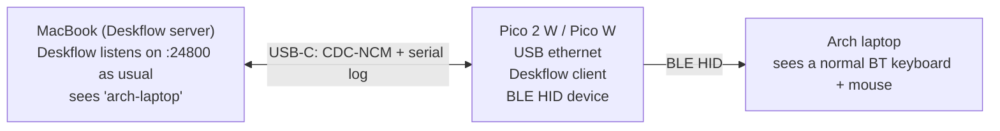
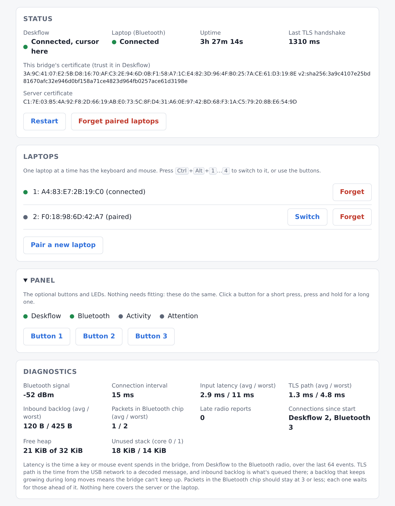
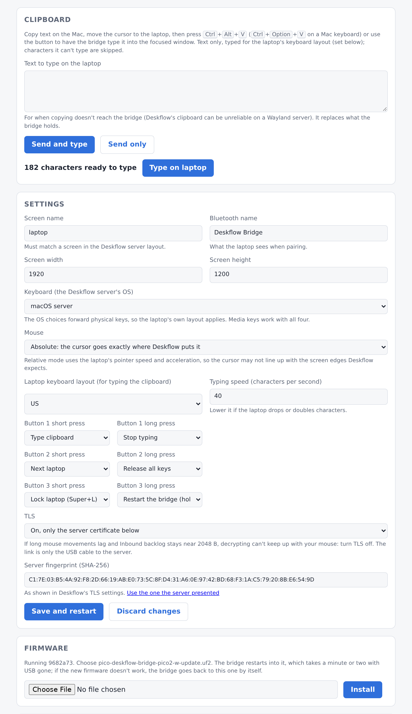
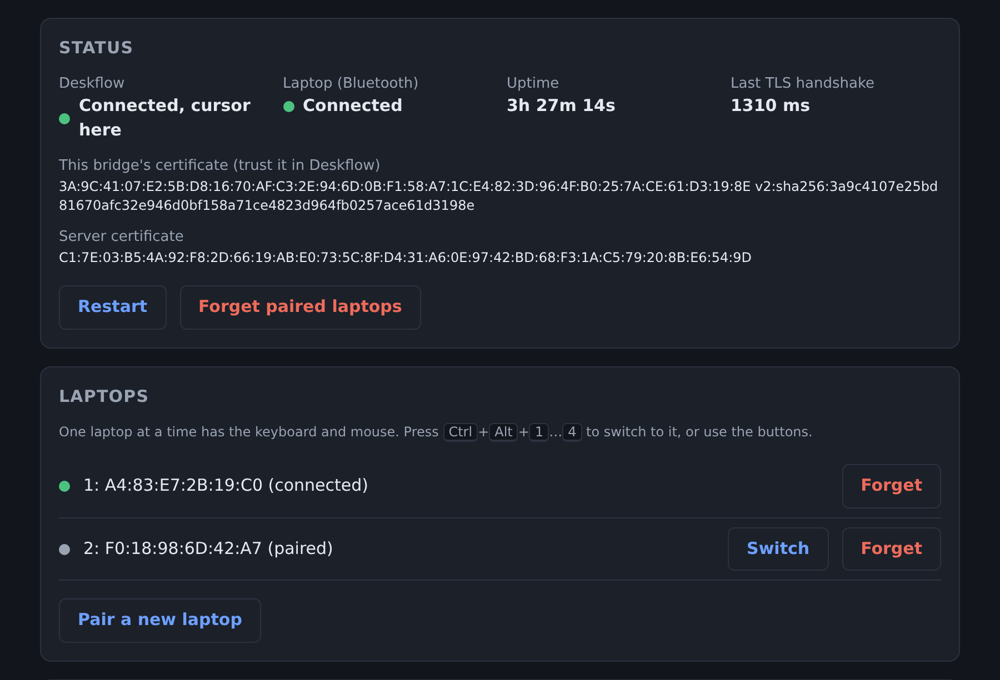
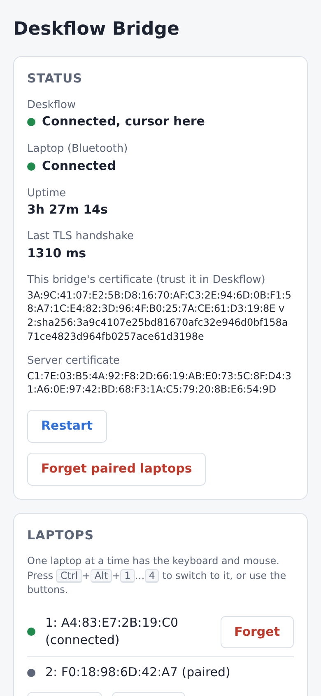

# pico-deskflow-bridge

[](https://github.com/N0t4R0b0t/pico-deskflow-bridge/actions/workflows/ci.yml)

Share one keyboard and mouse between two computers that are **not on the same
network**, using a Raspberry Pi **Pico 2 W** (or the original **Pico W**) as the
bridge. The plain Pico and Pico 2 have no radio and can't be used.



* The Pico enumerates on the Mac as a **USB network adapter** (CDC-NCM, driverless
  on macOS) and hands the Mac `192.168.77.2` over DHCP — with no router or DNS,
  so the Mac's normal traffic keeps using its usual network (Wi-Fi, VPN, a corporate LAN).
* It connects to Deskflow at `192.168.77.2:24800` as an ordinary client named
  `arch-laptop`. Deskflow has no idea it isn't a real computer.
* Keyboard and mouse events are forwarded to the laptop as a **Bluetooth LE HID**
  keyboard + absolute pointer. Nothing is installed on the laptop either.

Keys are forwarded **physically** (the server's key code → HID usage), so the
laptop's own layout applies and Alt shortcuts work. The server can be macOS,
Windows or Linux (set **Keyboard** on the [settings page](#settings-page)); on a
Mac, Cmd becomes Super and Option becomes Alt. Media keys (volume, playback,
brightness) are forwarded too.

## Screenshots

The bridge serves a settings page to the Deskflow server over the USB cable
(<http://192.168.77.1/>): status, paired laptops, diagnostics, clipboard,
settings, firmware updates, password and a live log. These are made from the
real page against a mock of the bridge, so the data is made up
([`tools/screenshots.py`](tools/screenshots.py) regenerates them).

<p align="center">
  
</p>
<p align="center">
  
</p>

It follows the system's dark mode and works on a phone-sized window:

<p align="center">
  
  &nbsp;
  
</p>

## Status

Run on a **Pico 2 W** against a Deskflow server on Linux (Wayland), with an
Arch Linux (X11) laptop and a Windows machine on the Bluetooth side. USB
networking, pairing and switching between laptops, TLS, keys, the mouse
(absolute and relative), the clipboard text box and the settings page have all
worked on that hardware.

* **Pico W** (RP2040): builds in CI and shares all the code, but hasn't been
  run on real hardware by the author. Firmware updates from the page are
  Pico 2 W only (the Pico W has no room for two images).
* **Optional buttons and LEDs** and **firmware updates from the page** have
  host tests, but the wiring hasn't been built and the update path has had
  only a first boot on hardware. Treat both as new.
* **macOS and Windows Deskflow servers**: the key tables follow Deskflow's
  source and are tested on the host, but the author hasn't run the bridge
  against a Mac or a Windows server. Reports welcome.

[TESTING.md](TESTING.md) is the hardware checklist, and the place to say what
you ran it on. CI runs the host tests (including TLS handshakes against
OpenSSL), clippy and the firmware build for both boards, and attaches the
`.uf2` files to each run.

| Piece | State |
|---|---|
| Deskflow protocol 1.6 (hello, info, keep-alive, keys, mouse, wheel) | works on hardware |
| Deskflow TLS 1.3 with server pinning and a client certificate | works on hardware |
| USB CDC-NCM + DHCP server, USB serial log | works on hardware |
| BLE HID keyboard, mouse, media keys; up to 4 paired laptops | works on hardware |
| Settings page, password, diagnostics, live log | works on hardware |
| Clipboard: server → laptop, typed out (text box when the server's clipboard doesn't arrive) | works on hardware |
| Clipboard: laptop → server, file transfer | not possible without software on the laptop |
| Firmware updates from the page (Pico 2 W) | boots on hardware; the update and rollback paths are untested |
| Optional buttons and LEDs | tested on the host; wiring not built yet |
| Pico W (RP2040) | builds in CI; not run on hardware |

## Repository layout

| Path | What |
|---|---|
| `deskflow-proto/` | `no_std` protocol codec, key tables, HID mapping, the TLS provider, clipboard reassembly and typing, settings/HTTP handling for the web page (`src/web/index.html`) and LED patterns. Pure logic, `cargo test` on the host (the TLS tests use `openssl` if it's installed). |
| `firmware/` | Firmware for the Pico 2 W (RP2350, default) and Pico W (RP2040): embassy, cyw43, trouble BLE host. Board differences are in `src/board.rs`. |
| `scripts/uf2.sh` | Builds the UF2 for a board; `scripts/elf2uf2.py` does the ELF → UF2 conversion (elf2uf2-rs can't do the RP2350). |
| `bootloader/` | The embassy-boot bootloader that swaps in uploaded updates (Pico 2 W). |
| `tools/tls-offload-test/` | Host test of the second-core TLS pipeline (`firmware/src/tls_offload.rs`) against `openssl s_server`: `cargo run --release`. |
| `tools/screenshots.py` | Regenerates the screenshots in `docs/screenshots/` from the page and a mock of its API. |
| `firmware/src/config.rs` | Defaults for the web page's settings, and the fixed USB network addresses. |
| `firmware/cyw43-firmware/` | CYW43439 Wi-Fi/BT firmware blobs (Infineon permissive binary license). |

## Download

Each [release](https://github.com/N0t4R0b0t/pico-deskflow-bridge/releases) has a
`.uf2` per board (and, for the Pico 2 W, an `-update.uf2` for installing from the
settings page). Every CI run also attaches them as artifacts, or you can
[build them yourself](#build). A Pico 2 W's first flash must be the full
`.uf2` (it carries the bootloader); after that, updates can come from the page.

## Build

Needs Rust (pinned by `rust-toolchain.toml`, which also installs both chip
targets), `flip-link` and Python 3. Nothing else: the UF2 conversion is a script in this repo.

```sh
cd deskflow-proto && cargo test     # host unit tests
./scripts/uf2.sh                    # Pico 2 W → pico-deskflow-bridge-pico2-w.uf2
./scripts/uf2.sh pico-w             # Pico W   → pico-deskflow-bridge-pico-w.uf2
```

In VS Code the same are the **Build UF2 (Pico 2 W)** (default build task) and
**Build UF2 (Pico W)** tasks. CI builds both and attaches them to each run.

In `firmware/`, `cargo build --release` builds for the Pico 2 W; `cargo pico-w`
is an alias for the Pico W build (`--target thumbv6m-none-eabi
--no-default-features --features pico-w`).

**Flash:** hold BOOTSEL while plugging the Pico in, then copy the board's
`.uf2` onto the drive that appears (`RP2350` for the Pico 2 W, `RPI-RP2` for
the Pico W). With the Pico attached to the build machine, `cargo run --release`
in `firmware/` builds and copies it directly.

## Setup

1. **Pico → Mac** via USB. A new network service ("Deskflow Bridge") appears in
   System Settings → Network and gets `192.168.77.2`. If `192.168.77.0/24` clashes
   with something, change `PICO_IP`/`HOST_IP` in `config.rs`.
2. **Deskflow server on the Mac**: add a screen named `arch-laptop` to the
   layout. Make sure macOS's firewall lets Deskflow accept incoming
   connections. TLS can stay on (see [TLS](#tls)).
3. **Laptop**: pair with "Deskflow Bridge" (`bluetoothctl` → `scan on`,
   `pair <addr>`, `trust <addr>`, `connect <addr>`). The bond is saved on the Pico,
   so it reconnects on its own after a power cycle.
4. Move the cursor off the Mac's screen edge toward the laptop.

To change the screen name, resolution or anything else, open the
[settings page](#settings-page). No reflashing needed.

### Clipboard

The laptop only sees a keyboard, so the bridge can't put anything on its
clipboard. Instead it **types** the Mac's clipboard: copy text on the Mac,
move the cursor to the laptop, click into a text field and press
**Ctrl+Alt+V** (Ctrl+Option+V on a Mac keyboard), or use "Type on laptop" on
the settings page.

* Text only, up to 64 KB (16 KB on a Pico W), at 40 characters a second by
  default (adjustable on the page). Pressing any key, or "Stop" on the page,
  stops it.
* Set the **laptop's keyboard layout** on the page (US, UK, German, French,
  Spanish, Swedish/Finnish) so symbols and accented letters come out right.
  The tables come from Linux's own layout data (xkeyboard-config).
  Characters the layout can't type directly (only through dead keys, or not
  at all, like emoji) are skipped, and the log says how many.
* Laptop → Mac isn't possible: the bridge can't read the laptop's clipboard.

### Settings page

Open **<http://192.168.77.1/>** on the Mac. It shows:

* **Status**: Deskflow connection, Bluetooth connection/pairing, uptime, and
  both TLS fingerprints (the Pico's, to trust in Deskflow, and the server's).
* **Diagnostics**: Bluetooth signal strength and connection interval, input
  latency (time an event spends in the bridge, average and worst of the
  last 64), connection counts since start, free heap and never-used stack.
* **Settings**: screen name, resolution, Bluetooth name, keyboard mode,
  mouse mode and TLS (including pinning the server's fingerprint with one
  click). **Mouse → Relative** sends movement like a real mouse instead of
  absolute positions; try it if the cursor misbehaves on a laptop with
  several monitors. The laptop's pointer acceleration then applies, so the
  cursor may not reach the edge exactly where Deskflow expects.
  "Save and restart" writes them to flash and restarts the Pico; the page
  reloads when it's back (a few seconds, while the Mac re-joins the USB
  network). Values saved here override the defaults in `config.rs`.
* **Laptops**: the paired laptops, with **Switch**, **Forget** and **Pair a new
  laptop**, which lets one connect for two minutes. **Ctrl+Alt+1…4**
  (Ctrl+Option on a Mac keyboard) switches too, by the numbers shown here.
* **Firmware** (Pico 2 W): which build is running, and installing a new one
  from `pico-deskflow-bridge-pico2-w-update.uf2`. USB goes away for a minute or
  two. If the new firmware doesn't bring up Deskflow or the page within 5
  minutes, or hangs, the bridge goes back to the old one by itself.
* **Panel**: virtual versions of the optional buttons and LEDs (see
  [Buttons and LEDs](#buttons-and-leds)). Click for a short press, hold for a
  long one.
* **Clipboard**: how much text the bridge holds, with "Type on laptop" and
  "Stop", and a box for text to type. Use the box when copying doesn't reach the
  bridge: Deskflow's clipboard can be unreliable on a Wayland server.
* **Log**: the last 8 KB of the log, updating live.
* **Restart** and **Forget paired laptops** (remove the old pairing on each
  laptop too).
* **Password** (optional): once set, changing anything needs it; tick "Also
  needed to see status and the log" to protect viewing too. It's stored
  hashed (PBKDF2-SHA256); logging in sets a session cookie that survives the
  bridge's restarts, and changing or removing the password logs everyone
  out. **Forgot it?** With the bridge running, hold its BOOTSEL button for
  5 seconds: the password is removed (the log says so). Holding BOOTSEL while
  plugging in starts the UF2 bootloader instead.

The page is only reachable over the USB cable. It only answers requests
addressed to `192.168.77.1` (not a hostname), and saving needs a header that
other websites open in the Mac's browser can't send. That stops them from
changing the settings behind your back. The password is for the people and
programs on the Mac itself.

### LED

The board's single LED (wired to the radio chip) shows the connection state:

| LED | Meaning |
|---|---|
| short blip every 2 s | running, but neither Deskflow nor the laptop is connected |
| slow blink (1 Hz) | one of them is connected |
| on | both connected |
| flickering while on | keyboard/mouse input is being forwarded |

### Buttons and LEDs

Purely optional: the firmware behaves the same with nothing fitted, and the
page's **Panel** does everything these do. [ASSEMBLY.md](ASSEMBLY.md) has the
parts list, wiring and checks.

**Deskflow** is on when connected and blinks while connecting; **Bluetooth** is
on when connected and blinks while pairing is open; **Activity** flickers with
input; **Attention** blinks on a problem the log explains. Each button's short
and long press are set on the settings page. A long press takes 1 s, or 5 s if
it restarts the bridge.

**Factory reset:** see [ASSEMBLY.md](ASSEMBLY.md#factory-reset).

### Logs

The log is on the [settings page](#settings-page), and also on a USB serial port:

```sh
screen /dev/tty.usbmodem* 115200    # on the Mac; Ctrl-A K to quit
```

You'll see the DHCP lease, the Deskflow connection, BLE pairing, and any
rejection (e.g. "add a screen named 'arch-laptop' to the server layout").

### TLS

Deskflow's defaults (TLS on, "check peer fingerprints" on) work as they are:

* **The Pico trusts the server.** Out of the box it accepts any certificate
  (the link is a USB cable straight into the Mac) and logs the server's
  fingerprint. To pin it, choose "only the server certificate below" on the
  settings page and click "Use the one the server presented" (check it
  against the fingerprint in Deskflow's TLS settings).
* **The server trusts the Pico.** On first boot the Pico generates a P-256
  key, keeps it in flash and logs its certificate fingerprint:

  ```
  deskflow: client fingerprint 1A:2B:…
  deskflow: (trusted-clients line: v2:sha256:1a2b…)
  ```

  Deskflow asks whether to trust a new client on its first connection; check
  it matches. Alternatively append the `v2:sha256:…` line to `tls/trusted-clients`
  in Deskflow's settings directory. The fingerprint is also on the settings
  page, and stays the same across reboots and renames.

If TLS is off on the server, set TLS to "Off" on the settings page.

## Configuration

Everything except the network addresses can be changed on the
[settings page](#settings-page). `firmware/src/config.rs` holds the defaults
used until settings are first saved there:

| Setting | Default | Notes |
|---|---|---|
| `SCREEN_NAME` | `arch-laptop` | Must match the screen in Deskflow's layout |
| `SCREEN_WIDTH` × `SCREEN_HEIGHT` | 1920×1200 | Laptop resolution; the pointer is absolute so mostly affects cursor speed |
| `KEY_SOURCE` | `MacPhysical` | The server's OS: `MacPhysical`, `WindowsPhysical`, `LinuxPhysical`; or `KeyId` (characters, US layout on the laptop) |
| `TLS` | `Some(ServerTrust::Any)` | `Pinned(parse_fingerprint("…"))` to pin the server, `None` if the server has TLS off |
| `BLE_NAME` | Deskflow Bridge | At most 22 characters |
| `PICO_IP` / `HOST_IP` | 192.168.77.1 / .2 | USB link subnet; build-time only, so the page can't lock itself out |

## Known limitations / next steps

* **TLS** is 1.3 only (`embedded-tls`) with RSA server keys up to 4096 bits,
  which covers Deskflow's generated certificates. It runs on the chip's
  second core, so handshakes don't stall USB, Bluetooth or the settings page;
  the page shows how long the last one took. Decrypting every mouse move is
  the limit on throughput: the Pico 2 W runs at 200 MHz (1.15 V, an overclock
  embassy calls experimental) to keep up with a fast mouse, confirmed on one
  setup. If long movements lag and **Inbound backlog** on the page stays near
  2048 B, as is likely on the slower Pico W, turn TLS off on both ends. The link
  is only the USB cable to the server, though other programs on the server can
  then reach it.
* Horizontal-scroll direction is unverified (`invert_pan` in `deskflow-proto/src/hid.rs`).
* Clipboard is one-way and typed (see [Clipboard](#clipboard)).
* Up to 4 laptops stay paired (pairing a fifth drops the oldest), and one at a
  time has the keyboard and mouse. Switching needs the laptop to reconnect,
  which is up to it and can take a few seconds. Laptops are shown by Bluetooth
  address.
* The USB IDs are the pid.codes test VID/PID (`1209:0001`); fine for personal use.

## Contributing and security

Bug reports, hardware results and pull requests are welcome: see
[CONTRIBUTING.md](CONTRIBUTING.md). To report a vulnerability privately, see
[SECURITY.md](SECURITY.md). [ROADMAP.md](ROADMAP.md) lists what's done and
what might come next; [ASSEMBLY.md](ASSEMBLY.md) covers the optional wiring.

## Acknowledgements

This builds on [Deskflow](https://github.com/deskflow/deskflow) (the protocol
this client speaks; the project isn't affiliated with or endorsed by it),
[Embassy](https://embassy.dev), [TrouBLE](https://github.com/embassy-rs/trouble),
[cyw43](https://github.com/embassy-rs/embassy/tree/main/cyw43) and
[embedded-tls](https://github.com/drogue-iot/embedded-tls). The keyboard
layout tables come from [xkeyboard-config](https://gitlab.freedesktop.org/xkeyboard-config/xkeyboard-config).

## License

MIT for the code in this repository (see [LICENSE](LICENSE)).
`firmware/cyw43-firmware/` holds the CYW43439 firmware blobs, which are
distributed under Infineon's permissive binary license (see the file in that
directory). The dependencies keep their own licenses.
